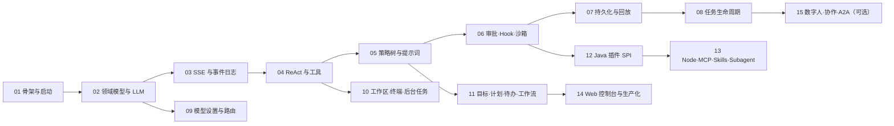

# DeepSeek Harness Java · 分阶段重建路线图

> 目标：不按 831 个类逐个读，而是按 **15 个可运行的能力切片**，从空工程开始，逐步重建出当前项目的核心能力。每一站都给出范围、任务、验收命令和对照源码；做完一站再进下一站。

---

## 1. 为什么这样学

当前项目已经是一个完整的 Agent 运行时，直接从头读会遇到三个问题：

1. **类太多**：7 个核心模块、831 个 main Java 类，按文件读很容易迷路。
2. **链路太长**：一次对话会穿过 trigger → api → case → domain → infrastructure 五层。
3. **概念交织**：ReAct、事件溯源、审批、插件、任务队列同时出现，分不清谁先谁后。

这份路线图采用 **纵向切片（vertical slice）**：

> 每一站只引入“让当前能力跑起来”所必需的类，先跑通，再对照正式源码补设计细节。

完成一站后，你会得到一个可启动、可验证的缩小版 Harness；15 站走完，核心能力与扩展面基本齐备。

---

## 2. 和现有文档的关系

| 文档 | 用途 |
| --- | --- |
| `README.md` | 项目整体介绍、启动方式、配置 |
| `docs/code-map/dsh-java-architecture/` | 架构全景 + 三张联动图，先建立空间感 |
| `docs/md/domain-course/` | 按领域模块读源码的“课程” |
| **`docs/rebuild-roadmap/`（本目录）** | 按“动手重建”的顺序拆分任务，每站一个可运行产物 |

建议顺序：

1. 先看架构全景图（10 分钟）
2. 读本目录 `README.md` 和金规则（10 分钟）
3. 从第 01 站开始，一次只做一站
4. 每完成一站，回到 `docs/md/domain-course/` 对应章节补理论

---

## 3. 五条重建金规则

这五条决定了你写出来的东西是不是“这个项目的架构”，而不只是“能跑的代码”。

1. **依赖方向不能反**
   ```text
   app → trigger → api/case → domain ← infrastructure
   domain → types
   ```
   `domain` 不依赖 `infrastructure`；`types` 不依赖 Spring；`case` 不直接依赖 DAO/HTTP Client。

2. **端口在 domain，实现在 infrastructure**
   需要外部能力时，先在 domain 定义 `I*Port` / `I*Repository`，再到 infrastructure 写实现。不要在 domain 里 `new` 数据库、HTTP、进程。

3. **复杂流程用策略树**
   单步查询/命令用薄 `*CaseImpl`；跨多个领域服务或包含分支的流程，用 `factory + node + DynamicContext`，节点通过 `getNext()` 显式路由。

4. **所有工具走同一条执行链**
   内置工具、插件工具、MCP 工具都注册进 `ToolRegistry`，统一由 `ToolCallExecutor` 执行：参数解析 → PRE Hook → 审批门禁 → 执行 → POST Hook → 事件回填。

5. **会话是事件日志，不是一张消息表**
   用户消息、助手增量、工具调用、工具结果都先变成 `SessionEvent`，再由 `SessionLog` 追加、`SurfaceProjector` 投影。不要绕过事件直接拼 UI 消息。

---

## 4. 总体阶段图



---

## 5. 阶段总表

| # | 阶段 | 这一站交付什么 | 主要模块 | 体量 | 前置 |
| --- | --- | --- | --- | --- | --- |
| 01 | 骨架与启动 | 7 模块工程能启动，`/actuator/health` 返回 UP | app / 全部 pom | S | — |
| 02 | 领域模型与 LLM | `POST /api/agent/message` 返回一次模型回复 | types / domain.llm / infra.llm | M | 01 |
| 03 | SSE 与事件日志 | 流式对话，事件可回放 | domain.session / trigger.stream | M | 02 |
| 04 | ReAct 与工具 | Agent 能读文件、执行 Shell 并回填结果 | domain.agent/tool / infra.shell/fs | L | 03 |
| 05 | 策略树与提示词 | 四节点 Agent 管线 + Prompt 装配 + 工作目录 | case.agent / domain.agent | M | 04 |
| 06 | 审批·Hook·沙箱 | 高风险工具挂起审批，越界命令被拦截 | task.permission/approval / sandbox / hooks | L | 05 |
| 07 | 持久化与回放 | 重启后按 agentId 恢复会话，长上下文压缩 | session.event / repository / schema | L | 06 |
| 08 | 任务生命周期 | 提交 → 权限 → 审批 → 入队 → 执行 | case.task / domain.task | M | 07 |
| 09 | 模型设置与路由 | 数据库渠道可切换，新增 provider 不改 Bean | runtime.setting / channel / llm | M | 02, 07 |
| 10 | 工作区·终端·后台任务 | 多工作区、交互终端、后台 Job | workspace / terminal / jobs | M | 04, 05 |
| 11 | 目标·计划·待办·工作流 | Goal / Plan / Todo / Workflow / Schedule | goal / plan / todo / workflow / schedule | L | 05, 07 |
| 12 | Java 插件 SPI | 安装 JAR → 激活 → Agent 看到插件工具 | types.spi / domain.plugin / infra.plugin | L | 06, 07 |
| 13 | Node·MCP·Skills·Subagent | 四种外部扩展面全部可用 | plugin.bridge / mcp / skill / subagent | L | 12 |
| 14 | Web 控制台与生产化 | 浏览器对话、审批、插件管理、Docker 启动 | app.static / trigger.filter / dev-ops | L | 08, 11 |
| 15 | 数字人·协作·A2A（可选） | 数字人房间、协作任务、AgentCard | digitalhuman / collaboration / A2A | M | 08, 12 |

**体量约定**：S ≈ 0.5–1 天；M ≈ 1–2 天；L ≈ 2–3 天。按每天 4–6 小时有效学习估算，全程约 5–7 周。

---

## 6. 每一站怎么用

每个阶段文档都按同一骨架写：

```text
这一站完成什么
前置检查
任务清单（按顺序做）
关键接口 / 类
最小实现 vs 正式实现
验收（命令 + 预期）
对照源码
常见坑
完成标志（checklist）
```

建议节奏：

1. **先读**阶段文档的“任务清单”和“验收”，不要急着写。
2. **只实现最小版本**，让验收命令通过。
3. **再读对照源码**，比较自己的设计和正式实现的差异。
4. **补测试**：至少一个单元测试 + 一个接口验收。
5. **打 tag**：`git tag stage-01`，再进下一站。
6. 在 `CHECKLIST.md` 里勾掉本站。

---

## 7. 验收约定

所有阶段尽量用同一套本地环境：

```bash
# 1. 编译
mvn -q -DskipTests package

# 2. 启动（H2，零外部依赖）
java -jar deepseek-harness-java-app/target/deepseek-harness-java-app-*.jar \
  --spring.profiles.active=standalone

# 3. 健康检查
curl -s http://localhost:8090/actuator/health
```

模型相关阶段需要：

```bash
export LLM_API_KEY='your-key'
# 或使用本地 OpenAI 兼容网关
export LLM_BASE_URL='http://127.0.0.1:8777/v1'
export LLM_DEFAULT_MODEL='gpt-5.5'
```

测试命令：

```bash
mvn -q -DskipTests=false test
```

> 项目根 pom 默认 `skipTests=true`，需要显式 `-DskipTests=false` 才会跑测试。

---

## 8. 目录索引

| 文件 | 内容 |
| --- | --- |
| [`CHECKLIST.md`](./CHECKLIST.md) | 15 站总进度表 + 每站完成定义 |
| [`01-skeleton-and-boot.md`](./01-skeleton-and-boot.md) | 多模块骨架、Spring Boot、H2、健康检查 |
| [`02-domain-model-and-llm.md`](./02-domain-model-and-llm.md) | 领域消息模型、LLM 端口与 OpenAI 适配器、一次性对话 |
| [`03-sse-and-session-events.md`](./03-sse-and-session-events.md) | SSE 协议、SessionEvent、SessionLog、投影 |
| [`04-react-loop-and-tools.md`](./04-react-loop-and-tools.md) | ReAct 循环、ToolRegistry、ToolCallExecutor、内置工具 |
| [`05-case-pipeline-and-prompts.md`](./05-case-pipeline-and-prompts.md) | 策略树、四节点、Prompt 装配、工作目录 |
| [`06-approval-hooks-sandbox.md`](./06-approval-hooks-sandbox.md) | 权限矩阵、审批 Broker、Hook、沙箱 |
| [`07-persistence-and-replay.md`](./07-persistence-and-replay.md) | MyBatis、事件落库、恢复、压缩 |
| [`08-task-lifecycle.md`](./08-task-lifecycle.md) | 任务提交链、审批、队列、执行状态机 |
| [`09-model-settings-and-routing.md`](./09-model-settings-and-routing.md) | 模型渠道、协议路由、模型发现、重试 |
| [`10-workspace-terminal-jobs.md`](./10-workspace-terminal-jobs.md) | 工作区、终端、后台 Job |
| [`11-goal-plan-todo-workflow.md`](./11-goal-plan-todo-workflow.md) | 目标、计划、待办、工作流、调度 |
| [`12-java-plugin-spi.md`](./12-java-plugin-spi.md) | Java 插件 SPI、ClassLoader、生命周期、热重载 |
| [`13-node-mcp-skills-subagents.md`](./13-node-mcp-skills-subagents.md) | Node Bridge、MCP、Skills、Subagent |
| [`14-web-console-and-production.md`](./14-web-console-and-production.md) | 原生 JS 控制台、认证、Docker、可观测性 |
| [`15-digital-human-collaboration-a2a.md`](./15-digital-human-collaboration-a2a.md) | 数字人、协作房间、A2A/AgentCard（可选） |

---

## 9. 一张图记住核心顺序

```text
先让灯亮起来        → 01 骨架
再让模型说一句话    → 02 一次性对话
再让字流出来        → 03 SSE + 事件
再让 Agent 动手     → 04 ReAct + 工具
再让流程有秩序      → 05 策略树
再让危险操作可控    → 06 审批 + 沙箱
再让会话不丢        → 07 持久化
再让任务能排队      → 08 任务生命周期
再让模型可切换      → 09 模型设置
再让工作区/终端可用 → 10 运行平台
再让目标/计划落地   → 11 规划能力
再让外部能力进来    → 12 Java 插件
再让协议生态进来    → 13 Node/MCP/Skills/Subagent
再让用户看得见      → 14 Web 控制台
最后接协作场景      → 15 数字人/协作/A2A（可选）
```

---

## 10. 领域包覆盖对照

`domain` 共有 29 个一级包。它们不必每个都单独成站，而是按能力归入最相关的阶段；阶段文档里会引用具体类。

| 领域包 | 主要落在哪一站 | 说明 |
| --- | --- | --- |
| `agent` | 04 / 05 | ReAct 循环、Agent 生命周期、Prompt 装配、Subagent 工具 |
| `llm` | 02 / 09 | LLM 端口、流式 chunk、BlockAssembler |
| `session` | 03 / 07 | 事件日志、投影、会话查询、恢复 |
| `tool` | 04 / 06 | ToolRegistry、ToolCallExecutor、内置工具族 |
| `task` | 06 / 08 | 权限、审批、队列、执行状态机 |
| `runtime` | 05 / 09 | 执行画像、模型设置、工具目录、token 计量 |
| `plugin` | 12 | Registry / Bridge / Runtime 三段 |
| `channel` | 09 | 渠道模板、协议、鉴权方式 |
| `goal` | 11 | 目标聚合与目标工具 |
| `plan` | 11 | 计划模式 |
| `todo` | 11 | 待办写入与事件 |
| `workflow` | 11 | 工作流运行态与引擎端口 |
| `schedule` | 11 | 定时任务（当前 InMemory 边界） |
| `jobs` | 10 | 后台 Job 注册表与工具 |
| `terminal` | 10 | 交互终端端口与工具 |
| `sandbox` | 06 | 三档沙箱策略 |
| `guard` | 06 | 超时、重复调用提醒等守卫 |
| `hooks` | 06 | Hook 点、Hook 结果、Hook 服务 |
| `skill` | 13 | 文件系统技能包 |
| `extension` | 13 | Skills/MCP 的可写配置与管理 |
| `acp` | 13 / 15 | ACP Agent 端口与外部子 Agent |
| `coderuntime` | 10 / 13 | 本地代码运行时端口 |
| `e2b` | 10 / 13 | 远程沙箱端口（当前 Stub） |
| `lsp` | 10 | LSP 工具 |
| `sdk` | 13 | stdio SDK 传输端口 |
| `typert` | 13（可选） | Typert 协议注册表与加载器 |
| `storage` | 07 | JSON/KV 存储后端 |
| `credentials` | 02 / 09 / 14 | 本地凭据与 YAML 存储 |
| `shared` | 01 / 07 | 跨域状态枚举等共享类型 |

> 覆盖原则：**核心链路单独成站，外围能力挂到最相关的阶段**。如果你只关心 Agent 主线，做到 09 就能理解 80%；要完整覆盖项目能力，再走 10–15。
